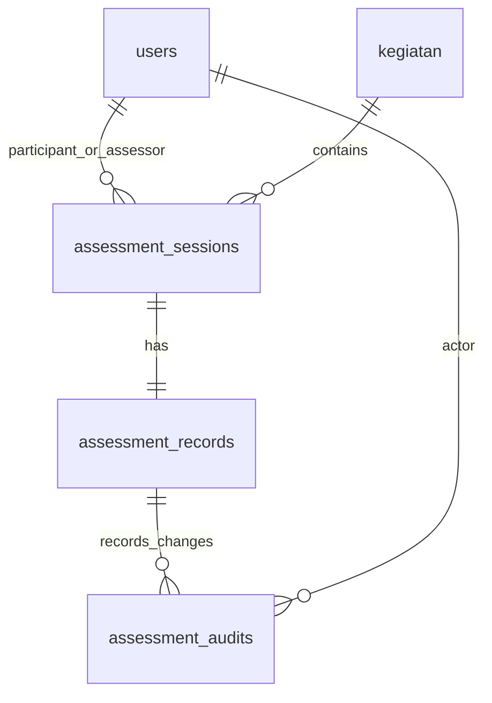
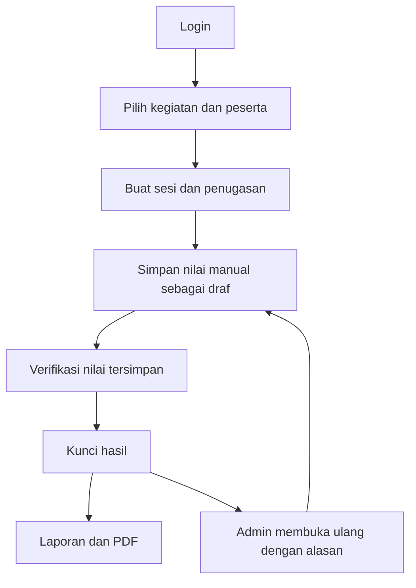
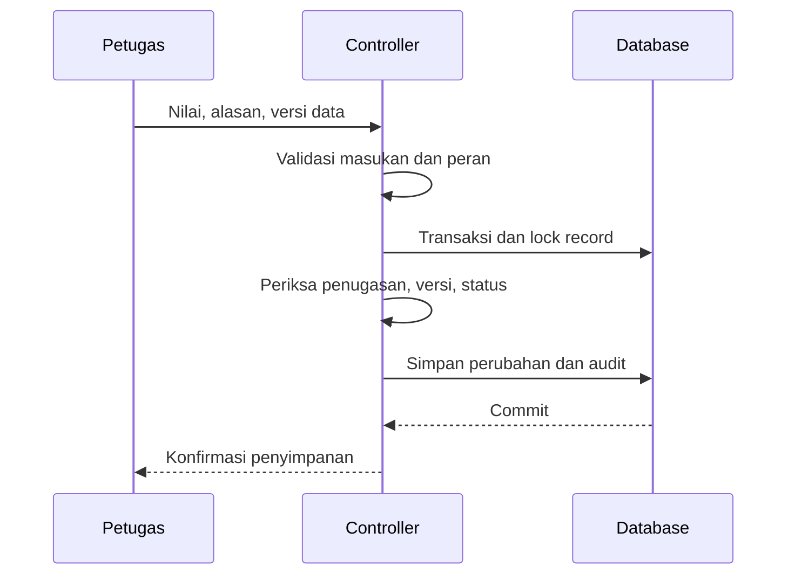

# Administrasi penilaian — panduan implementasi

## Ruang lingkup

Branch ini menyediakan aplikasi administrasi Laravel: akun, peran, kegiatan, sesi, pencatatan nilai manual, lampiran privat, verifikasi, penguncian, riwayat perubahan, laporan dan PDF. Tidak mengubah model AI, deteksi, kalibrasi, atau perhitungan skor otomatis. Nilai total diisi petugas; rentang 0–1.000.000 hanya batas penyimpanan umum, bukan aturan penilaian cabang tertentu.

**Perubahan kompatibilitas:** halaman `/upload-target` menuju administrasi. POST `/evaluate-target` dan `/api/save-assessment` lama mengembalikan 410 setelah autentikasi; keduanya tidak lagi dapat menulis ID dummy. Kode lama tetap disimpan untuk referensi. `/leaderboard` menuju laporan hasil terkunci, tanpa pemeringkatan baru. Review perubahan alur ini sebelum merge.

Data `penilaian_header` dan `penilaian_detail_titik` lama tidak dihapus atau diubah. Modul baru memakai tabel tersendiri. Data lama belum ditampilkan dalam laporan baru dan tidak dimigrasikan otomatis karena identitas dummy tidak dapat dipetakan dengan aman. Jangan menganggap seluruh data historis sudah berpindah.

## Pemasangan

Prasyarat: PHP 8.2+ sesuai composer.lock, Composer, ekstensi pdo_sqlite (pengujian), mbstring, xml, curl, zip, gd, fileinfo; database MySQL atau SQLite. UI administrasi menggunakan CSS lokal dalam Blade, tanpa kebutuhan CDN atau build Node.

Dari `src/web-app`:

```sh
composer install
cp .env.example .env
php artisan key:generate
```

Atur koneksi database di `.env`, `APP_URL`, zona waktu yang disepakati, dan `APP_DEBUG=false` di deployment. SQLite: buat file `database/database.sqlite`, lalu isi `DB_CONNECTION=sqlite` dan path absolut `DB_DATABASE`. MySQL: isi host, port, database, username, password. Cadangkan database dan storage sebelum menjalankan migrasi pada instalasi lama.

```sh
php artisan migrate
php artisan admin:create
php artisan serve
```

Perintah `admin:create` meminta nama, email, dan kata sandi secara interaktif. Tidak ada akun admin/password bawaan. Jangan gunakan `migrate:fresh` pada database berisi data. Seeder baru tidak menghapus isi tabel dan tidak membuat akun dummy. Akun lama dengan password contoh perlu diganti sebelum penggunaan nyata.

Buka `/login`. Administrator membuat akun petugas/peserta dan kegiatan. Peserta juga dapat mendaftar melalui `/register`; server selalu menetapkan role peserta. Role `perwira` lama diperlakukan sebagai pembaca hasil miliknya sendiri, tanpa akses seluruh peserta.

## Alur penggunaan

1. Administrator membuat kegiatan, akun, dan penugasan sesi; petugas boleh membuat sesi untuk dirinya sendiri.
2. Pilih kegiatan aktif, peserta, petugas, dan nomor sesi. Kombinasi kegiatan/peserta/nomor sesi harus unik.
3. Petugas yang ditugaskan atau administrator memasukkan nilai manual, catatan dan foto opsional, lalu menyimpan draf dengan alasan.
4. Verifikasi nilai yang sudah tersimpan. Tombol verifikasi tidak menyimpan input yang belum disimpan.
5. Kunci hasil. Hasil terkunci muncul pada laporan dan dapat diunduh sebagai PDF.
6. Hanya administrator dapat membuka ulang hasil terverifikasi/terkunci, dengan alasan wajib. Hasil kembali menjadi draf dan hilang dari laporan hingga dikunci lagi.

Peserta hanya melihat hasilnya sendiri yang terkunci. Petugas hanya melihat sesi yang ditugaskan kepadanya. Administrator melihat seluruh sesi. Lampiran disimpan di disk privat `local`, disajikan melalui route berautentikasi dengan pemeriksaan akses hasil. Path lampiran tidak diterima dari browser.

## Kebutuhan dan bukti implementasi

| ID | Kebutuhan | Implementasi | Pengujian |
|---|---|---|---|
| A01 | Login, logout, registrasi peserta | AccountController, session regeneration, throttle | login/logout, role injection, guest |
| A02 | Pengelolaan akun dan kegiatan | AdministrationController::user/activity | pembatasan admin |
| A03 | Sesi dengan identitas nyata | session, FK dan unique constraint | peserta valid, duplikat, penugasan |
| A04 | Nilai manual dengan validasi | update action save | bilangan negatif/desimal, alasan wajib |
| A05 | Draf → verifikasi → kunci | update, transaksi DB | urutan status, immutable locked |
| A06 | Riwayat perubahan | assessment_audits, snapshot sebelum/sesudah | audit setiap transisi |
| A07 | Konflik penyuntingan | row lock dan version | stale request 409 |
| A08 | Laporan/PDF sesuai akses | query scope, report/pdf | draf disembunyikan, PDF dan isolasi peserta |
| A09 | Foto privat | disk local, route foto | akses petugas/peserta/orang lain |
| A10 | Penyiapan tidak menghapus data | seeder non-destruktif | seed menjaga data lama |

## ERD ringkas



`assessment_records`: nilai manual, catatan, path foto, status, versi, verifikator dan waktu. `assessment_audits`: aktor, tindakan, alasan, snapshot JSON sebelum/sesudah dan waktu. Audit tidak memiliki endpoint edit/hapus. Ini audit tingkat aplikasi, bukan jaminan anti-manipulasi terhadap administrator database.

## Pengujian

```sh
php artisan test
php artisan view:cache
php artisan route:list
```

Suite memakai SQLite in-memory melalui phpunit.xml, terpisah dari database aplikasi. Pengujian MySQL dan konkurensi nyata dua koneksi masih perlu dilakukan pada lingkungan deployment. UAT: login sebagai tiap peran, buat kegiatan/sesi, simpan draf, lampirkan foto, verifikasi, kunci, buka laporan/PDF, lalu buka ulang dengan admin. Pastikan identitas dan nilai sama pada form, database, audit dan PDF. Catat hasil aktual, perangkat/browser, tanggal, dan penguji; jangan menandai UAT lulus sebelum dicoba pengguna.

## Rollback dan batasan

Sebelum merge, uji branch pada salinan database. Untuk kembali ke aplikasi lama, checkout commit sebelumnya. Jangan rollback/drop tabel baru bila sudah ada hasil yang perlu dipertahankan; ekspor atau cadangkan dahulu. Foto versi sebelumnya dipertahankan karena path-nya tercatat pada audit, sehingga diperlukan kebijakan retensi dan backup storage. Laporan PDF tidak menanamkan foto. Tidak ada fitur lupa password/email delivery, MFA, edit peran akun, penghapusan kegiatan, tanda tangan digital, atau migrasi identitas historis pada perubahan ini.

Konfigurasi layanan lama berada di `services.cv_engine.url` dari `CV_ENGINE_URL`; hanya dirapikan agar endpoint konsisten dan koneksi memiliki timeout. Modul administrasi manual tidak membutuhkan layanan Python untuk berjalan.

## Diagram aktivitas dan urutan penyimpanan





Hasil verifikasi aktual tersedia pada [ADMINISTRASI_TESTING.md](ADMINISTRASI_TESTING.md).
