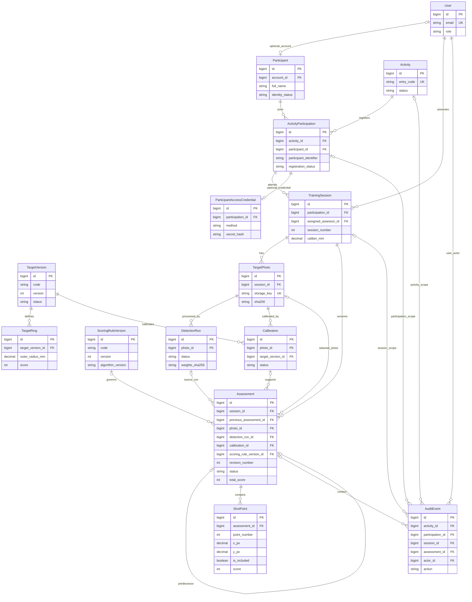

# Database Design Baseline v1.1 — TA Sistem Skoring Menembak

**Status:** baseline rancangan untuk implementasi bertahap; **bukan** pengesahan aturan operasional lapangan.  
**Berasal dari:** hasil analisis Codex *Database Design Baseline v1* dan *v1.1* yang dibagikan ke percakapan 01 — Master Plan & Progress.  
**Kode tujuan:** Django (Python), model utama Computer Vision YOLO26s, scoring geometris otoritatif pada server.  
**Repository tujuan:** `TA-Sistem-Skoring-Menembak`, branch `feat/django-migration`, lokasi dokumen `docs/DATABASE_DESIGN_BASELINE_v1.1.md`.  
**Penting:** Dokumen ini merekonsiliasi bagian v1 yang **tetap berlaku** dengan perubahan v1.1. Belum merupakan hasil pemeriksaan ulang source code atau hasil pengujian database.

## 1. Prinsip dan keputusan baseline

- Tiga Django apps: `accounts`, `activities`, `assessments`. Modul Computer Vision/geometri dapat berupa paket Python biasa, bukan tambahan Django app.
- Primary key model baru: integer 64-bit otomatis (`BigAutoField`). ID dari Laravel tidak otomatis dijadikan PK atau identitas terverifikasi.
- `User` dan `Participant` dipisah; peserta boleh tidak mempunyai akun Django.
- `ActivityParticipation` adalah **CORE** dan menjadi satu-satunya hubungan peserta–kegiatan yang dirujuk `TrainingSession`. Satu peserta dapat mempunyai beberapa sesi per kegiatan.
- Satu petugas ditugaskan per sesi pada baseline; riwayat pergantiannya diaudit. Model penugasan lebih kompleks ditunda.
- Satu `Assessment` merepresentasikan **satu versi/revisi** hasil suatu sesi (tanpa tabel `AssessmentRevision` terpisah); revisi locked bersifat immutable, revisi baru tidak mengubah data lama.
- Semua skor resmi dihitung di server dari titik yang disertakan, kalibrasi, geometri target, kaliber, dan aturan scoring berversi. Total/skor dari browser bukan sumber kebenaran.
- Hasil mentah YOLO dan hasil koreksi/verifikasi manusia disimpan terpisah. Kegagalan inferensi berbeda dari inferensi berhasil tanpa deteksi; skor 0 berbeda dari skor belum dihitung (`NULL`).
- Foto asli privat, tidak ditimpa, dan dapat dilacak ke hasil/inferensi. Konfigurasi target serta aturan scoring yang sudah diterbitkan immutable.
- Foreign key untuk bukti historis menggunakan kebijakan `PROTECT` (atau pembatasan setara); jangan menghapus riwayat resmi melalui cascade rutin.
- PostgreSQL adalah **kandidat DBMS utama**, belum dikonfirmasi melalui pengujian PostgreSQL aktual. Tes fondasi Django sebelumnya menggunakan SQLite dalam memori.
- Nilai manual resmi dan impor historis **bukan** fitur CORE v1.1. Bobot lama `best.pt` merupakan aset baseline historis, bukan bobot YOLO26s baru.

### 1.1 Status pengambilan keputusan

| Keputusan | Status |
|---|---|
| Django sebagai framework utama | Final |
| YOLO26s object detection sebagai model tujuan | Final |
| UI dark mode, modern command center, tactical profesional | Final sebagai arah desain |
| Peserta dapat melakukan registrasi mandiri | Keputusan kebutuhan pengguna, **belum terakomodasi utuh** pada detail v1.1 |
| `ActivityParticipation` sebagai CORE | Baseline v1.1 |
| Aktivasi kredensial peserta token/PIN | OPTIONAL; mekanisme dan distribusi menunggu validasi |
| Sesi = giliran individu; satu target, satu petugas per sesi | Asumsi sementara, menunggu observasi |
| Scoring dan ukuran target terpublikasi | Perlu validasi aturan lapangan sebelum dipakai untuk hasil resmi |
| Pengujian produksi, performa model, hosting internet | Belum dilakukan |

**PERBEDAAN TERBUKA YANG WAJIB DITANDAI DALAM IMPLEMENTASI:** Baseline v1.1 menuliskan `registered_by` wajib FK ke `User` karena mengasumsikan pendaftaran oleh petugas, tetapi kebutuhan pengguna menyebut **registrasi mandiri**. Jangan mengimplementasikan kewajiban petugas secara permanen sehingga menutup alur pendaftaran mandiri. Desain actor/source registrasi harus diselesaikan dahulu ketika modul registrasi dibuat. Demikian pula `AuditEvent.actor -> User` wajib pada v1.1, tetapi aksi peserta tanpa akun membutuhkan atribusi aktor yang benar; jangan mengarang akun staff/dummy untuk mewakili peserta. Keduanya merupakan **isu desain terbuka**, bukan izin mengubah seluruh skema secara diam-diam.

## 2. Klasifikasi 14 model CORE

| Django app | Model CORE | Fungsi |
|---|---|---|
| `accounts` | `User` | Autentikasi dan kewenangan |
| `accounts` | `Participant` | Identitas peserta independen dari akun |
| `activities` | `Activity` | Kegiatan latihan dan akses kegiatan |
| `activities` | `ActivityParticipation` | Status keikutsertaan dan pengenal dalam kegiatan |
| `activities` | `TrainingSession` | Sesi individu, konteks latihan, petugas |
| `assessments` | `TargetVersion` | Definisi target fisik per versi |
| `assessments` | `TargetRing` | Radius dan skor tiap ring |
| `assessments` | `ScoringRuleVersion` | Aturan scoring per versi |
| `assessments` | `Assessment` | Hasil berversi, draf/verifikasi/locked |
| `assessments` | `TargetPhoto` | Bukti gambar privat |
| `assessments` | `DetectionRun` | Hasil mentah satu inferensi |
| `assessments` | `Calibration` | Transformasi gambar → bidang target |
| `assessments` | `ShotPoint` | Titik yang dikoreksi dan dinilai |
| `assessments` | `AuditEvent` | Riwayat aksi penting |

Model OPTIONAL: `ParticipantAccessCredential` (`activities`), `AssessorAssignment` (`activities`), `ManualScoreEntry` (`assessments`). Model/tabel DEFERRED: `AssessmentRevision` terpisah, `LegacyAssessmentRecord`, katalog model/dataset, tabel materialisasi leaderboard/laporan.

`ParticipantAccessCredential` termasuk **OPTIONAL**, walaupun alur peserta mandiri akan membutuhkan keputusan autentikasi sebelum diaktifkan. Jangan menafsirkan OPTIONAL sebagai perintah menghapus kebutuhan registrasi mandiri.

## 3. Konvensi atribut, hubungan, constraint

- PK: `BigAutoField`, timestamps timezone-aware; `created_at` untuk seluruh entitas dan `updated_at` pada entitas yang boleh diubah.
- Teks opsional boleh berupa string kosong; FK/tanggal/angka yang belum diketahui menggunakan `NULL` (sesuaikan dengan validasi spesifik).
- Skor berbentuk integer nonnegatif pada baseline; kebutuhan skor pecahan menunggu konfirmasi.
- Status/action menggunakan nilai terbatas dengan constraint yang relevan.
- Data JSON dibatasi untuk parameter, hasil mentah, transformasi, dan snapshot; relasi domain tidak diganti dengan JSON.
- Unique/FK/CheckConstraint ditegakkan pada database bila memungkinkan. Validasi lintas entitas dan otorisasi tetap harus dilakukan dalam layanan domain/transaksi, tidak mengandalkan `clean()` saja.

### 3.1 `accounts`

| Model | Atribut utama | Aturan |
|---|---|---|
| `User` | Email, nama tampilan, `role`, status aktif, field autentikasi Django | Email dinormalisasi dan unik tanpa membedakan kapital; role kandidat `admin`, `scorer`, `peserta`, `perwira`; hak admin-site tidak otomatis memberi kewenangan bisnis |
| `Participant` | Nama lengkap, nomor identitas opsional, status identitas `pending`/`verified`, akun opsional, pengesah identitas/waktu | `account` opsional One-to-One ke `User`; `verified` mensyaratkan petugas dan waktu; nama tidak unik; nomor identitas belum dapat diberi unique global |

Custom User wajib ditentukan sebelum migration awal (sudah dilakukan pada fondasi Django menurut laporan implementasi); validasi atribut perlu mengikuti kontrak layanan/form. Jangan mengasumsikan hash password Laravel kompatibel langsung dengan Django.

### 3.2 `activities`

#### `Activity`

| Atribut | Tipe konseptual / aturan |
|---|---|
| `name` | String hingga 255, **tidak unik** |
| `training_date` | Date |
| `status` | `draft`, `active`, `closed` |
| `created_by` | FK `User`, PROTECT |
| `entry_code` | String acak hingga 64, nullable, unik saat terisi |
| `participant_access_opens_at` | Timestamp nullable |
| `participant_access_closes_at` | Timestamp nullable |

Jika kode akses diaktifkan, kedua waktu akses wajib tersedia dan waktu akhir harus lebih besar daripada waktu awal. Akses mengharuskan kegiatan `active`; rotasi kode dicatat di audit. **Kode kegiatan bukan autentikasi/otorisasi** dan pengetahuannya saja tidak memberi hak membaca hasil peserta.

#### `ActivityParticipation` — CORE (tambahan v1.1)

| Atribut | Tipe konseptual / aturan |
|---|---|
| `activity` | FK `Activity`, wajib, PROTECT |
| `participant` | FK `Participant`, wajib, PROTECT |
| `registration_status` | `pending`, `approved`, `rejected`, `withdrawn` |
| `participant_identifier` | String maks. 64, nullable, ternormalisasi, unik **dalam kegiatan** bila terisi |
| `registered_at` | Timestamp wajib |
| `registered_by` | FK `User`, wajib **menurut asumsi pendaftaran petugas v1.1; perlu diselesaikan untuk registrasi mandiri** |
| `decided_by`, `decided_at` | FK `User` nullable dan waktu keputusan nullable |
| `status_reason` | Teks alasan perubahan status |
| `edit_version` | Integer positif, mulai 1 |

Constraint: unique `(activity, participant)`; unique bersyarat `(activity, participant_identifier)` bila identifier terisi, dengan identifier kosong dinormalisasi `NULL`. Status `approved` atau `rejected` memerlukan pengambil keputusan dan waktu; `approved` memerlukan identifier; `rejected` dan `withdrawn` memerlukan alasan. Hubungan kegiatan/peserta tidak boleh diubah setelah sesi dibuat; semua transisi status diaudit. `participant_identifier` **bukan secret** dan belum tentu sama dengan nomor identitas resmi.

#### `TrainingSession`

| Atribut | Tipe konseptual / aturan |
|---|---|
| `participation` | FK `ActivityParticipation`, wajib, PROTECT; **tidak menduplikasi `activity` dan `participant`** |
| `session_number` | Integer positif; unique `(participation, session_number)` |
| `assigned_assessor` | FK `User` (satu petugas aktif pada baseline), PROTECT |
| `weapon_type` | Kandidat `laras_panjang` / `pistol` |
| `shooting_position` | Kandidat `berdiri` / `duduk` / `tiarap` |
| `distance_m` | Decimal kandidat `(8,2)`; positif |
| `caliber_mm` | Decimal kandidat `(5,2)`; positif, kandidat baseline 5.56 / 9.00 |
| `created_by` | FK `User`, PROTECT |
| `edit_version` | Integer positif, mulai 1 |

Pembuatan sesi mensyaratkan kegiatan aktif, partisipasi `approved`, identitas terverifikasi, dan petugas berwenang (asumsi kebijakan sebelum observasi). `withdrawn` menutup sesi baru, tidak menghapus hasil lama. Jangan memberi default tersembunyi untuk jarak/sikap. Kombinasi jenis senjata–kaliber divalidasi di server. Status identitas dan ketentuan pengesahan menunggu observasi lapangan.

### 3.3 `assessments`: konfigurasi target dan aturan

| Model | Atribut utama | Constraint |
|---|---|---|
| `TargetVersion` | Kode, versi, nama, lebar/tinggi bidang (mm), status `draft`/`published`/`retired`, pembuat, waktu publikasi | Unique `(code, version)`; versi ≥ 1, ukuran positif; published/retired immutable |
| `TargetRing` | FK `TargetVersion`, nomor/urutan ring dari pusat, radius luar (mm), nilai skor | Unique `(target_version, ring_number)`; radius > 0; skor > 0 pada baseline |
| `ScoringRuleVersion` | Kode, nomor versi, status, metode inward, versi/identitas algoritma, kebijakan batas, presisi numerik, pembuat, waktu publikasi | Unique `(code, version)`; versi ≥ 1; published/retired immutable; tidak mengeksekusi rumus bebas dari database |

Saat publikasi konfigurasi: ring minimal satu, radius bertambah ke luar, skor menurun ke arah luar, geometri sesuai bidang, tidak ambigu dan satuan konsisten. `TargetRing` dinormalisasi menjadi tabel, bukan JSON ring bebas. Besaran pada engine lama **tidak otomatis diakui sebagai standar target sah**.

### 3.4 `assessments`: foto, inferensi, kalibrasi

| Model | Atribut utama | Constraint/relasi |
|---|---|---|
| `TargetPhoto` | FK sesi, private storage key, SHA-256 file, MIME terverifikasi, byte size, dimensi piksel, pengunggah, versi preprocessing | File asli immutable/tidak ditimpa; key unik, ukuran/dimensi > 0; akses mengikuti otorisasi sesi/hasil |
| `DetectionRun` | FK foto, pemicu, status `pending`/`running`/`succeeded`/`failed`, nama model, SHA-256 bobot, versi runtime/adapter, parameter inferensi, hasil mentah JSON, mulai/selesai, kode kegagalan | Run yang selesai immutable; nihil deteksi ≠ gagal; simpan bounding box, kelas, confidence, dan ID deteksi |
| `Calibration` | FK foto dan target version, status `draft`/`accepted`/`rejected`, matriks transformasi, versi metode, pembuat/penerima, waktu diterima | Kalibrasi accepted immutable; matriks numerik berbentuk tetap/tervalidasi |

Kontrak koordinat: titik disimpan pada **piksel gambar analisis yang tetap**; kalibrasi mentransformasikannya ke bidang target dalam **milimeter**, dengan pusat target sebagai titik nol; skor dihitung pada bidang milimeter. Skala, rotasi, dan orientasi wajib konsisten dengan `preprocessing_version`. Gambar turunan boleh ada sebagai aset turunan, tetapi foto asli tetap dipertahankan dengan hubungan asal–turunan yang jelas.

### 3.5 `assessments`: hasil, titik, audit

| Model | Atribut utama | Constraint/relasi |
|---|---|---|
| `Assessment` | FK sesi; `revision_number`; predecessor self-FK opsional One-to-One; `status`, `edit_version`; FK foto, `DetectionRun` opsional, `Calibration`, `ScoringRuleVersion`; `total_score`, catatan; pembuat, verifikator, pengunci dan timestamps | Unique `(session, revision_number)`; predecessor harus revisi terakhir sesi yang sama; nomor/versi ≥ 1; total nullable atau ≥ 0 |
| `ShotPoint` | FK `Assessment`, `point_number`, X/Y piksel, `source` AI/manual, ID deteksi asal opsional, `is_included`, skor server | Unique `(assessment, point_number)`; nomor ≥ 1; X/Y finite dan dalam bidang gambar; skor nullable atau ≥ 0 |
| `AuditEvent` | FK activity/participation/session (lingkup utama XOR), assessment opsional, actor FK `User`, action, alasan, state sebelum/sesudah, waktu | Append-only aplikasi; satu dari tiga lingkup utama terisi; assessment hanya untuk lingkup sesi dan harus sesuaikan sesinya; actor non-User untuk peserta mandiri **belum terselesaikan** |

Pada draf, foto/kalibrasi/rule boleh belum lengkap; semuanya harus ada sebelum verifikasi geometris. `DetectionRun` boleh NULL jika AI gagal dan titik dimasukkan/koreksi manual, tetapi skor tetap geometris oleh server. Kalibrasi menentukan versi target sehingga FK target tidak perlu diduplikasi pada `Assessment`.

`Assessment` tidak menggunakan `current_assessment_id` pada sesi atau `is_current_official` tersimpan; hasil ditentukan melalui urutan nomor revisi dan status. Unique bersyarat yang didukung DBMS dapat membatasi maksimal satu versi `draft`/`verified` per sesi; layanan domain juga wajib mengamankannya terhadap race condition.

#### Indeks dan relasi (gabungan v1 → v1.1)

- Indeks sesuaikan query: `(assigned_assessor, ...)` pada sesi melalui keikutsertaan/kegiatan; `(status, locked_at)` pada Assessment; `(photo, created_at)` pada DetectionRun; `(session, created_at)` serta `(assessment, created_at)` pada AuditEvent.
- Tambahan v1.1: `(activity, registration_status)` pada ActivityParticipation, serta indeks activity/participation dan waktu pada AuditEvent.
- Unique `(participation, session_number)`, `(activity, participant)`, `(activity, participant_identifier)` saat terisi, dan `(session, revision_number)`; hindari indeks duplikat.
- Semua FK historis `PROTECT`; pastikan aturan lintas entitas melalui layanan domain, bukan hanya keberadaan FK.

## 4. Alur data sampai hasil resmi

1. Identitas peserta dibuat/ditemukan, lalu partisipasi kegiatan dicatat. **Alur registrasi mandiri perlu diselesaikan**, jangan dijadikan pendaftaran petugas saja.
2. Penugasan petugas dan `TrainingSession` disiapkan dengan konteks senjata, sikap, jarak, dan kaliber yang diketahui.
3. `Assessment` revisi pertama dimulai sebagai `draft` tanpa skor resmi.
4. Foto asli diambil/diunggah, disimpan privat, diberi metadata dimensi, integritas, dan ruang koordinat.
5. `DetectionRun` menyimpan identitas YOLO26s/bobot, status sukses/gagal, serta keluaran mentah.
6. `Calibration` yang valid diterima untuk memetakan koordinat ke milimeter.
7. Titik AI dikonversi menjadi `ShotPoint`; petugas menerima, menambah, memindahkan, atau mengeluarkan titik dengan jejak audit.
8. Server menghitung ulang skor tiap titik aktif dan total menurut versi target/rule. Skor dari klien diabaikan sebagai otoritas.
9. Revisi diverifikasi dan dikunci (`draft → verified → locked`) dalam transaksi yang memeriksa hak, status, versi dan data penilaian.
10. Laporan resmi membaca revisi locked yang tepat; foto, konfigurasi, model, dan versi historis tetap dapat dilacak.

### 4.1 Revisi dan hasil resmi (kebijakan v1.1 menggantikan v1)

- **Versi kerja terbaru** = `Assessment` dengan `revision_number` terbesar pada sesi.
- **Hasil resmi terakhir** = `Assessment` `locked` dengan `revision_number` terbesar pada sesi.
- `locked` tidak diubah. Buka ulang oleh pihak berwenang membuat versi baru `draft` yang menunjuk predecessor. Titik versi lama tetap tersimpan.
- Revisi draf/verified **tidak membuat hasil locked lama hilang dari histori/detail**. Tampilkan label *hasil resmi terakhir — sedang ditinjau* bila ada versi kerja lebih baru.
- Setelah revisi lebih baru locked, hasil locked sebelumnya diberi label historis *telah digantikan*; PDF historis mencantumkan identitas versi/waktu.
- Baseline leaderboard: **hasil dengan revisi terbaru masih ditinjau tidak dimasukkan ke peringkat aktif**, walaupun hasil locked terdahulu tetap dapat ditelusuri. Ini **asumsi sementara yang harus dikonfirmasi**.

### 4.2 Validitas scoring

- Ring berbasis geometri target terpublikasi; penilaian inward menggunakan radius lubang berdasarkan kaliber dan aturan batas ring berversi.
- Menyentuh batas ring bernilai lebih tinggi merupakan kebijakan awal dari SRS, tetapi toleransi numerik dan aturan tepat di garis harus diuji dan disahkan.
- Titik di luar **ring** dapat bernilai 0; titik di luar **bidang gambar** ditolak.
- Skor `NULL` = belum dihitung, berbeda dari 0; kegagalan AI berbeda dari sukses 0 deteksi.
- Jumlah titik tidak otomatis dipaksa sama dengan jumlah butir sebelum aturan tembakan meleset/tumpang tindih dikonfirmasi.
- Skor total locked harus sama dengan hasil hitung server atas semua titik yang disertakan; hasil manual tidak diam-diam dianggap hasil YOLO.

## 5. Mekanisme akses kegiatan dan kredensial OPTIONAL

`Activity.entry_code` hanya mengarahkan ke konteks kegiatan. Jika fitur autentikasi peserta diaktifkan, kredensial berlaku untuk **satu** `ActivityParticipation` dan tidak boleh tersimpan dalam plaintext.

### `ParticipantAccessCredential` (OPTIONAL)

| Atribut | Jenis/aturan |
|---|---|
| `participation` | One-to-One FK, PROTECT |
| `method` | `token` atau `pin` |
| `secret_hash` | Digest/hash aman, bukan secret plaintext |
| `generation` | Integer positif, meningkat saat diterbitkan ulang |
| `issued_by`, `issued_at`, `expires_at` | FK petugas dan timestamps; expires > issued |
| `consumed_at`, `revoked_at` | Nullable |
| `failed_attempts`, `locked_until` | Pembatasan percobaan/pemblokiran |

Token acak berentropi tinggi adalah opsi awal; PIN dapat menggunakan password hasher bersalt. Secret tidak boleh dicatat pada URL, audit, log atau snapshot. Penerbitan ulang membatalkan kredensial lama; autentikasi sekali pakai harus atomik. Rate limiting menyeluruh tetap diperlukan, termasuk per sumber request.

**Parameter pilot belum final:** masa berlaku kredensial 15 menit, maksimal 5 kegagalan, blokir 15 menit, masa sesi peserta maks. 30 menit (atau sampai jendela akses tutup), alternatif PIN acak minimal 8 digit. Angka ini bukan keputusan operasional final.

Sesi autentikasi tanpa akun dapat memakai sesi server-side yang menyimpan principal peserta kegiatan, `participation_id`, `activity_id`, `generation`, waktu autentikasi/kedaluwarsa. Setiap request memverifikasi status partisipasi, kegiatan, jendela akses, pencabutan/generation, dan otorisasi resource. Jangan mencampur principal peserta dengan sesi akun petugas. Status `consumed_at` mencegah login baru, tetapi tidak otomatis mengakhiri sesi yang sudah terbit; pencabutan/generation membatalkannya.

**Isu terbuka:** penerbitan token oleh petugas dalam sumber v1.1 belum tentu cocok dengan registrasi mandiri peserta. Tentukan proses penerbitan/distribusi bersama kebutuhan operasional; jangan menambahkan alur otomatis tanpa keputusan.

## 6. Konsistensi, keamanan dan histori

- Tindakan perubahan titik, penghitungan skor, kenaikan `edit_version`, dan audit menggunakan transaksi atomik.
- Kunci record sesi dahulu secara konsisten sebelum melakukan pembukaan revisi/perubahan hasil; periksa status dan versi untuk mencegah pembaruan bersamaan.
- Inferensi dilakukan **di luar** transaksi database panjang; hasil terlambat tidak boleh menimpa foto/revisi yang sudah berganti.
- Saat mengonsumsi token sekali pakai, lakukan locking kredensial; kegagalan autentikasi harus tetap menyimpan penghitung percobaan tanpa ter-rollback.
- File storage tidak menjadi satu transaksi atomik dengan database; tangani file yatim tanpa menghapus gambar yang masih direferensikan histori.
- Audit mencakup aksi kegiatan/partisipasi, penerbitan dan pencabutan akses, pembuatan/perubahan sesi, upload, pemilihan inferensi, kalibrasi, koreksi titik, verifikasi, penguncian, pembukaan revisi. Audit aplikasi append-only **bukan jaminan anti-manipulasi administrator DB**.
- Setelah locked: foto, run selesai, kalibrasi accepted, target/rule published dan hasil/titik terkait tidak diedit; metadata historis (kaliber, jenis senjata, jarak/sikap) tidak boleh berubah diam-diam.
- Jangan otomatis memetakan ID dummy dari Laravel ke peserta nyata, mengimpor hasil manual lama sebagai AI, menghitung ulang histori tanpa jejak, atau menyetarakan locked lama dengan verified Django.
- Kontrol akses harus diuji untuk mencegah peserta melihat hasil/foto/PDF kegiatan atau orang lain; HTTPS, rate limiting, private media, konfigurasi PostgreSQL/TLS merupakan pekerjaan keamanan sebelum akses internet.

## 7. ERD konseptual terkonsolidasi (14 CORE + satu OPTIONAL)

**Keterangan:** ERD hanya merangkum relasi utama. FK aktor tambahan (`created_by`, `verified_by`, dst.) tidak seluruhnya digambar; tabel atribut tetap menjadi sumber rinci. Relasi activity/participation/session pada `AuditEvent` adalah **XOR** (tepat satu lingkup utama), bukan semuanya wajib. Diagram memuat kredensial OPTIONAL agar relasinya terlihat.

## 8. Acceptance criteria untuk implementasi

Kriteria berikut adalah target verifikasi, **bukan hasil pengujian yang sudah lulus**.

### Inti yang berasal dari v1

1. Custom `User` sudah ditetapkan sebelum migration awal.
2. Akun dan peserta dapat berdiri terpisah; hubungan One-to-One tidak boleh ganda.
3. Peserta boleh mempunyai beberapa sesi; nomor sesi unik dalam keikutsertaan/kegiatan.
4. FK bukti historis tidak terhapus melalui cascade rutin.
5. Target dan scoring rule published tidak dapat diedit.
6. Publikasi target menolak urutan ring/ukuran/geometri tidak valid.
7. Foto, run, kalibrasi, assessment yang tidak satu konteks ditolak.
8. Gagal inferensi ≠ inferensi sukses dengan nol deteksi.
9. Total/skor yang dikirim klien tidak dapat mengubah nilai otoritatif server.
10. Tes scoring: pusat, batas ring, radius kaliber, di luar ring, kegagalan kalibrasi.
11. Koreksi titik meningkatkan versi dan menghasilkan audit secara atomik.
12. Request versi lama ditolak tanpa perubahan parsial.
13. Hasil `locked` immutable, koreksi membuat revisi baru.
14. Dua permintaan buka ulang bersamaan tidak membuat cabang revisi ganda.
15. Query hasil harus membedakan versi kerja dan hasil resmi; **aturan laporan menggunakan kebijakan v1.1 pada §4.1**, bukan menyembunyikan locked lama seperti rancangan v1.
16. Foto privat hanya dapat diakses sesuai hak sesi/hasil.
17. Histori dengan ID dummy tidak otomatis menjadi hasil resmi.
18. Constraint dan konkurensi diuji pada DBMS tujuan, bukan hanya SQLite tes.

### Tambahan dan perubahan dari v1.1

19. Peserta hanya memiliki satu partisipasi dalam kegiatan yang sama.
20. Sesi mengambil kegiatan/peserta melalui partisipasi, tanpa FK duplikat.
21. Partisipasi yang belum `approved` tidak dapat membuat sesi (asumsi workflow).
22. Identifier yang sama boleh dipakai di kegiatan lain, tetapi tidak duplikat dalam kegiatan yang sama.
23. Kode kegiatan saja tidak memberi akses data peserta atau hasil.
24. Token/PIN asli tidak disimpan di DB, URL, audit, atau log.
25. Kredensial expired, consumed, revoked atau locked ditolak tanpa membocorkan apakah identitas terdaftar.
26. Percobaan gagal tersimpan konsisten termasuk pada request bersamaan.
27. Kredensial sekali pakai tidak dapat menghasilkan dua autentikasi berhasil.
28. Penerbitan ulang/pencabutan menginvalidasi sesi peserta terdampak.
29. Peserta kegiatan A tidak dapat membaca data kegiatan B.
30. Seorang peserta tidak dapat membaca foto/PDF/hasil peserta lain dalam kegiatan yang sama.
31. Penarikan keikutsertaan tidak menghapus histori dan menutup akses token/PIN.
32. Membuka ulang tidak mengubah record `locked` sebelumnya.
33. Detail membedakan versi kerja terbaru dan hasil resmi terakhir.
34. Riwayat memberi label *sedang ditinjau* dan *telah digantikan* secara benar.
35. Leaderboard tidak menyertakan hasil sedang ditinjau sesuai kebijakan sementara.
36. Audit menolak lingkup utama kosong atau lebih dari satu.
37. Permintaan bersamaan tidak membuat sesi atau revisi duplikat.
38. Fitur token/PIN dapat dinonaktifkan tanpa memengaruhi akun petugas dan penilaian utama.

### Kriteria tambahan dari keputusan pengguna yang BELUM dirinci pada v1.1

39. Sistem harus dapat mendukung registrasi mandiri peserta, bukan hanya petugas; mekanisme verifikasi/approval harus ditetapkan sebelum endpoint registrasi diselesaikan.
40. Aktivitas peserta tanpa akun Django harus dapat diaudit secara akurat dengan identitas/ruang lingkup yang benar, bukan akun petugas fiktif.

Nomor 39–40 adalah **keputusan/kebutuhan tambahan yang disampaikan dalam koordinasi pengguna**, bukan bagian orisinal laporan Codex v1.1; implementasi detail masih perlu disepakati.

## 9. Asumsi observasi dan keputusan terbuka

- Sesi sebagai giliran individu, satu petugas dan satu target dinilai per sesi; bila lapangan memakai gelombang bersama atau beberapa target, domain diperluas tanpa mengubah riwayat yang sudah benar.
- Peran dan wewenang admin/petugas/perwira, hak verifikasi sendiri, dan hak laporan lintas kegiatan memerlukan observasi.
- Identitas peserta yang sah, verifikasi identitas, tata cara registrasi mandiri, distribusi kode/token, dan approval belum final.
- Aturan target/ring, ukuran fisik, garis batas, lubang menumpuk, kaliber, jumlah tembakan dan meleset harus disahkan serta diuji sebelum skor digunakan resmi.
- Skor berupa integer pada baseline; skema pecahan dan tie-break/ranking lintas jenis latihan menunggu konfirmasi.
- Keberadaan hasil manual sebagai hasil resmi masih OPTIONAL.
- Selama revisi berlangsung, nilai locked sebelumnya tetap terlihat pada detail, tetapi pengecualian dari leaderboard masih kebijakan sementara.
- Hak akses setelah peserta `withdrawn`, masa retensi gambar/histori, dan pemetaan data lama perlu keputusan operasional.
- Kontrak image preprocessing dan kualitas kalibrasi harus diuji agar titik YOLO, kanvas dan scoring berada pada ruang koordinat yang sama.
- PostgreSQL, pilihan deployment, worker inferensi, rate limiting, SSL/TLS, backup, dan observabilitas perlu ditentukan/diuji sebelum sistem diakses publik.

## 10. Rujukan kode hasil audit (untuk verifikasi Codex)

Rujukan ini disalin dari hasil audit Codex sebelumnya; **bukan** bukti verifikasi ulang dalam dokumen ini:

- `src/web-app/database/migrations/0001_01_01_000000_create_users_table.php` (skema lama; sekitar baris 15, 43, 52, 60, 75).
- `src/web-app/app/Http/Controllers/TargetController.php` (ID tetap sekitar baris 58, skor dari browser sekitar baris 65).
- Commit `c2ade23` pada `origin/codex/administrasi-penilaian-manual`: `src/web-app/database/migrations/2026_10_28_000001_create_administration_tables.php` (sekitar baris 11) dan `src/web-app/app/Http/Controllers/AdministrationController.php` (sekitar baris 95, 109, 116–148).
- `src/ai-engine/main_api.py` (inferensi dan output koordinat sekitar baris 52–64).
- `src/ai-engine/shooting_engine.py` (kalibrasi sekitar baris 22, perhitungan sekitar baris 39–44).
- `docs/SRS_v0.1.md` (kebutuhan awal yang belum seluruhnya tervalidasi observasi).

## 11. Panduan pemakaian baseline untuk Codex

1. Gunakan dokumen ini sebagai **baseline v1.1 terkonsolidasi**, bukan perintah otomatis untuk langsung membuat semua model.
2. Ketika ada kontradiksi antara atribut lama dan koreksi v1.1, **perubahan v1.1 mengungguli v1**. Untuk registrasi mandiri dan audit peserta tanpa User, **jangan anggap rincian v1.1 final**; tandai solusi yang dipilih secara eksplisit sebelum fitur tersebut diimplementasikan.
3. Periksa kode fondasi Django yang sudah ada (`accounts.User`) terlebih dahulu; jangan mengganti migrasi awal yang sudah dipakai hanya karena nama atribut konseptual tidak identik.
4. Implementasikan domain secara bertahap dengan test dan review. Jangan mengubah Laravel/FastAPI lama atau menyentuh database historis tanpa instruksi.
5. Pastikan semua angka aturan penilaian dan identitas akses bertanda **asumsi sementara** sampai hasil observasi petugas tersedia.